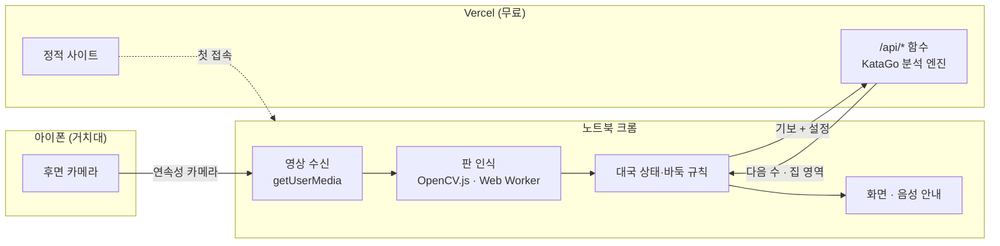
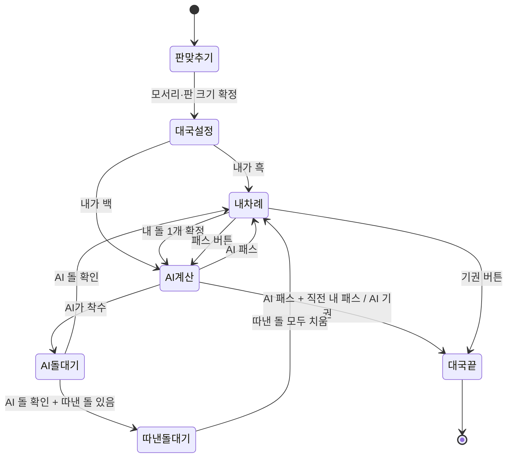

# 실시간 바둑판 인식 AI 대국 웹사이트 기획서 (완성본)

2026-11-16 · @원빈 · 1차 기획서(2026-11-15)를 바탕으로 정리

## 1. 개요

거치대에 꽂은 아이폰으로 실제 바둑판을 찍으면, 노트북 웹사이트가 돌의 위치를 실시간으로 인식해요. 그러면 AI가 다음 수를 화면과 음성으로 알려줘요. 사용자는 실제 돌로 두면서 원하는 기력의 AI와 대국할 수 있어요.

- **대상 사용자**: 개발자가 아닌 외국인 친구 1명이에요. 명령어 입력이나 프로그램 설치 없이 써야 해요.
- **언어**: 화면과 음성 안내는 모두 **영어**예요.
- **원칙 1, 설치 없음**: 링크만 열면 되는 웹사이트예요.
- **원칙 2, 비용 0원**: Vercel 무료(Hobby) 플랜에 올려요. 개인·비상업 용도라서 Hobby 조건에 맞아요.
- **기준 기기**: 2019년 인텔 또는 2021년 M1 맥북 프로 + 아이폰 + 폰 거치대 + 크롬

### 1차 기획서에서 바뀐 점

| 항목 | 1차 기획서 | 완성본 | 이유 |
| --- | --- | --- | --- |
| 폰↔노트북 연결 | QR + WebRTC(PeerJS) | **맥 연속성 카메라** | 친구가 아이폰을 써요. 연결 코드가 필요 없어요 |
| 판 크기 | 사용자가 선택 | **카메라로 자동 인식** | 설정 단계를 줄여요 |
| AI 위치 | 브라우저 (TF.js/ONNX Web) | **Vercel 서버 함수** | 모델 다운로드와 기기 성능 차이가 없어지고, KataGo를 그대로 쓸 수 있어요 |
| AI 강도 | 기기 속도에 맞춰 자동 | **사용자가 기력 선택 (Human SL)** | 친구가 이길 수도 있어야 재미있어요 |
| 대국 설정 | 사용자는 항상 흑 | **흑/백 선택** | |
| 대국 종료 | 없음 | **패스·기권·집계산** | |
| AI 수 안내 | 빨간 점 + 소리 | **빨간 점 + 좌표 음성 (영어)** | 사용자는 실제 판을 보고 있어요 |
| 화면 언어 | 한국어 | **영어** | 친구가 외국인이에요 |
| AI가 돌을 따낼 때 | 없음 | **"이 돌을 치워주세요" 단계** | 따낸 돌은 사람이 직접 들어내야 해요 |

## 2. 사용자 흐름

처음 한 번만 1~3단계를 하면 돼요. 다음부터는 아이폰을 꽂고 사이트를 열면 바로 시작해요.

1. **아이폰 꽂기**: 거치대에 아이폰을 꽂아 바둑판 전체가 보이게 해요. 화면은 잠가 둬요. 잠긴 상태여야 연속성 카메라가 동작해요.
2. **사이트 열기**: 노트북 크롬에서 북마크한 주소에 들어가요. "카메라 허용"을 누르고 카메라 목록에서 아이폰을 골라요. 사이트를 여는 순간 AI 서버도 미리 깨워요.
3. **판 맞추기**: 노트북 화면의 영상에서 판의 네 모서리(가장 바깥 선이 만나는 점)를 클릭해요. 사이트가 판 크기(9/13/19)를 알아내고, 인식한 빈 판을 옆에 그려요. 판이 비어 있으면 이때 밝기 기준값도 저장해요.
4. **대국 설정**: 내 돌 색(흑/백)과 AI 기력(예: 10급, 1단)을 골라요. 덤은 6.5집이에요.
5. **대국**
   - **내 차례**: 돌을 두고 손을 빼면 1~2초 뒤 화면에 내 돌이 찍혀요.
   - **AI 차례**: AI가 둘 자리를 빨간 점으로 보여주고 "White, D 16"처럼 음성으로 읽어줘요. 내가 그 자리에 AI 돌을 놓아요.
   - **따낸 돌**: AI 수로 내 돌이 잡히면 잡힌 돌에 X 표시와 "Remove 3 stones" 안내가 떠요. 다 치우면 다음으로 넘어가요.
   - AI 돌을 엉뚱한 자리에 놓으면 경고가 떠요.
6. **대국 끝**: 내가 "패스"를 누르고 AI도 패스하면 집계산 결과(예: "Black wins by 3.5")와 집 영역을 보여줘요. "기권" 버튼도 있어요.
7. **문제가 생기면**: "한 수 무르기", "판 직접 고치기"(화면에서 교차점 클릭), "모서리 다시 찍기" 버튼을 써요.

## 3. 시스템 구조

- **아이폰**: 카메라 역할만 해요. 앱도, 웹페이지도 열지 않아요.
- **노트북 브라우저**: 판 인식, 착수 감지, 바둑 규칙, 화면 표시를 맡아요. 영상은 밖으로 나가지 않아요.
- **Vercel 함수**: 지금까지의 기보와 설정을 받아 다음 수, 승률, 집 영역을 돌려줘요. 서버는 상태를 저장하지 않아서 요청마다 전체 기보를 보내요.

## 4. 대국 상태 흐름

어느 상태에서든 "판이 이상해요" 상태로 갈 수 있어요. 인식한 판이 예상과 다를 때 들어가고, 사용자가 판을 고치거나 직접 수정하면 원래 상태로 돌아와요.

## 5. 핵심 기능 상세

### 5.1 판 인식 (브라우저, OpenCV.js)

가장 불확실한 부분이에요. 폰을 고정해서 모서리를 한 번만 잡으면 되는 덕분에 많이 쉬워져요.

1. **원근 펴기**: 사용자가 클릭한 네 모서리로 원근 변환을 해서 판을 반듯한 정사각형으로 펴요. 클릭 위치는 근처 선 교차점으로 살짝 맞춰 줘요.
2. **판 크기 자동 인식**: 편 이미지에서 가로·세로 선 성분을 뽑아요. 그다음 N=9/13/19일 때 예상 선 위치와 실제 선이 얼마나 잘 맞는지 점수를 매겨 가장 높은 N을 골라요. 1등과 2등 점수 차이가 작으면 "19줄 판이 맞나요?"라고 물어봐요.
3. **빈 판 보정**: 판이 비어 있을 때 각 교차점 주변 밝기를 기준값으로 저장해요. 조명이 고르지 않아도 칸마다 기준을 따로 둬서 버텨요.
4. **돌 판정**: 각 교차점 주변 작은 원 영역의 밝기를 기준값과 비교해 빈칸/흑/백으로 나눠요.
   - 폰이 비스듬하면 돌 윗면이 교차점에서 카메라 반대쪽으로 밀려 보여요. 샘플 위치를 그만큼 보정해요.
   - 정확도가 부족하면 작은 CNN 분류기로 바꿔요. 그때 쓸 수 있게 인식 결과와 사용자가 고친 결과를 학습 데이터로 모아 둬요.
5. **움직임 감지**: 1초에 3~5프레임을 작은 해상도로 비교해요. 판 영역 변화가 크면 손이 들어와 있다고 보고 판정을 쉬어요. 0.7초 정도 조용해지면 그때 판을 읽어요.
6. **확정**: 조용해진 뒤 연속 2~3번 같은 판이 나와야 확정해요.

모든 영상 처리는 Web Worker에서 돌려서 화면이 끊기지 않게 해요.

### 5.2 착수 감지와 바둑 규칙 (브라우저)

확정된 판을 대국 상태가 기대하는 판과 비교해요.

| 상태 | 정상 변화 | 처리 |
| --- | --- | --- |
| 내 차례 | 내 돌 1개 추가 (+ 규칙상 따내지는 AI 돌이 사라짐) | 착수 확정, AI 호출 |
| AI 돌 대기 | 지정한 자리에 AI 돌 1개 추가 | 따낸 돌 대기 또는 내 차례로 이동 |
| AI 돌 대기 | 다른 자리에 AI 돌 추가 | "빨간 점 자리에 놓아 주세요" 경고 |
| 따낸 돌 대기 | 표시한 돌이 사라짐 | 다 사라지면 내 차례로 이동 |
| 공통 | 착수 금지 자리(자충수, 패)에 착수 | "둘 수 없는 자리예요" 경고 |
| 공통 | 그 밖의 변화 (돌 2개 이상 추가 등) | "판을 확인해 주세요" + 차이 나는 칸 표시 |

- 바둑 규칙은 직접 구현해요. 따내기, 자충수 금지, 패(단순 패) 판정, 따낸 돌 수를 다뤄요.
- 내가 둔 수로 AI 돌을 따냈는데 아직 판에서 안 치웠으면, 따낸 돌에 X 표시를 하고 치울 때까지 기다려요.

### 5.3 바둑 AI (Vercel 함수)

- **엔진**: KataGo 분석 엔진(analysis engine)과 Human SL 모델(`b18c384nbt-humanv0`)을 써요.
  - 1순위: Vercel 함수 안에서 KataGo 리눅스 CPU 바이너리를 실행해요. 함수 인스턴스가 살아 있는 동안 프로세스를 띄워 두고 재사용해요.
  - 2순위(1순위가 안 되면): `onnxruntime-node`로 신경망만 돌리고, 입력 특징 만들기와 수 고르기는 직접 구현해요.
- **기력 선택**: Human SL 모델은 모델 하나에 기력을 입력값으로 넣는 구조예요. 고를 수 있는 기력은 18급~9단이고, 화면에서는 몇 단계만 추려서 보여줘요.
- **수 고르기**: 그 기력의 사람이 둘 법한 수의 확률 분포에서 뽑아요. 깊게 탐색하지 않아서 한 수 계산이 빨라요.
- **규칙**: 한국 규칙(집 계산), 덤 6.5집이에요. 접바둑은 MVP에서 빼요.
- **집계산**: 대국이 끝나면 KataGo의 영역 판정(ownership)으로 사석과 집을 정하고, 따낸 돌 수와 덤을 더해 결과를 내요. 화면에는 집 영역을 색으로 칠해서 보여줘요.
- **콜드 스타트 대책**: 사이트를 열 때 `/api/warmup`을 불러 모델을 미리 올려 둬요. 대국 중에는 1~2분마다 가볍게 다시 불러요.

**API 초안**

| 경로 | 입력 | 출력 |
| --- | --- | --- |
| `POST /api/warmup` | 없음 | `{ ready }` |
| `POST /api/move` | `{ size, moves, aiColor, rank, komi }` | `{ move: "D16" \| "pass" \| "resign", winrate }` |
| `POST /api/score` | `{ size, moves, komi }` | `{ ownership, deadStones, result: "B+3.5" }` |

### 5.4 화면과 음성

- **노트북 화면**: 왼쪽에 아이폰 영상(판 테두리와 교차점 겹쳐 그리기), 오른쪽에 인식된 판(canvas), AI 다음 수(빨간 점), 승률 막대, 상태 안내 문구, 버튼(패스, 기권, 무르기, 판 고치기, 모서리 다시 찍기)이 있어요.
- **음성 안내**: 브라우저 내장 음성 합성(speechSynthesis, `en-US`)을 써요.
  - AI 수: "White, D 16" (열은 A~T에서 I를 뺀 영문, 행은 아래에서부터 세는 숫자, 표준 GTP 표기)
  - 그 밖의 안내: "Remove 3 stones", "Please check the board", "Black wins by 3.5"
- **화면 문구**: 모두 영어예요. 기력은 "10 kyu", "1 dan"처럼 표시해요.
- **소리**: 첫 음성이 나오려면 사용자가 페이지를 한 번 클릭해야 해서, "Start game" 버튼을 누를 때 음성을 켜 둬요.

### 5.5 오류 수정

- **한 수 무르기**: 마지막 내 수와 AI 수를 함께 되돌려요. 실제 판도 그만큼 돌을 빼라고 안내해요.
- **판 직접 고치기**: 화면 판의 교차점을 클릭할 때마다 빈칸 → 흑 → 백 순서로 바뀌어요. 이렇게 고친 판이 기준 판이 돼요.
- **모서리 다시 찍기**: 폰이 움직였을 때 써요. 판의 네 모서리 근처 선이 예상 위치에서 크게 벗어나면 먼저 안내해요.
- 대국 상태는 브라우저 저장소에 저장해서 새로고침해도 이어서 둘 수 있어요.

## 6. 기술 스택

React + Vite + TypeScript 프론트와 Vercel 함수(Node.js) 백엔드를 레포 하나에 둬요. 폴더 구조, 의존 규칙, 라이브러리, 테스트, Git 전략은 [`docs/아키텍처.md`](./아키텍처.md)에 정리했어요.

| 영역 | 사용 기술 |
| --- | --- |
| 화면 | React 19 + Vite, Tailwind CSS v4, canvas |
| 상태 | zustand (대국), react-query (AI 호출), zod |
| 카메라 | getUserMedia + 맥 연속성 카메라 |
| 판 인식 | 직접 구현 (Web Worker + Comlink), OpenCV 안 씀 |
| 바둑 규칙 | 직접 구현 (TypeScript) |
| 바둑 AI | Vercel 함수 + KataGo 분석 엔진 + Human SL 모델 |
| 음성·문구 | speechSynthesis (en-US), i18next (en) |
| 호스팅 | Vercel Hobby |

## 7. 성능 목표

| 항목 | 목표 |
| --- | --- |
| 내 돌을 두고 손을 뺀 뒤 화면에 찍히기까지 | 2초 이내 |
| AI 한 수 응답 (서버가 깨어 있을 때) | 1초 이내 |
| 서버가 잠든 뒤 첫 응답 | 10초 이내 (warmup으로 대국 전에 끝내기) |
| 19줄 판 돌 인식 정확도 (평범한 실내 조명) | 교차점 기준 99.5% 이상 |

위 숫자는 목표예요. 0단계와 1단계에서 실제로 재고 고쳐요.

## 8. 비용

| 항목 | 서비스 | 비용 |
| --- | --- | --- |
| 사이트 호스팅 | Vercel Hobby | 무료 |
| AI 계산 | Vercel 함수 (Hobby 무료 한도 안) | 무료 |
| 카메라 연결 | 맥 연속성 카메라 | 무료 |
| 도메인 (선택) | `*.vercel.app` 그대로 사용 | 무료 |

한 판에 AI 호출은 100~200번 정도이고, 한 번에 CPU를 1초도 안 써요. 사용자가 1명이라 Hobby 한도 안에 충분히 들어올 거예요. 0단계에서 실제 사용량을 확인해요.

## 9. 개발 단계

가장 불확실한 것부터 검증하고, 각 단계의 완료 기준을 넘으면 다음으로 가요.

| 단계 | 내용 | 완료 기준 |
| --- | --- | --- |
| **0. 기술 검증** | ① 아이폰을 판을 내려다보는 각도로 꽂아도 크롬에서 연속성 카메라로 잡히는지 ② KataGo 바이너리 + Human SL 모델이 Vercel 함수에서 돌아가는지 | ① 영상이 크롬에 나옴 ② `/api/move`가 기력별로 수를 돌려주고, 응답 시간과 콜드 스타트 시간을 잼 |
| **1. 판 인식** | 실제 판 사진·영상으로 원근 펴기, 판 크기 인식, 돌 판정 | 조명이 다른 사진 20장 이상에서 판 크기 100%, 돌 99.5% 이상 |
| **2. 대국 흐름** | 착수 감지, 바둑 규칙, 상태 흐름, AI 연결, 따낸 돌 처리 | 실제 판으로 19줄 한 판을 끝까지 둠 (사람이 고친 횟수 기록) |
| **3. 마감** | 음성 안내, 집계산, 패스/기권, 무르기, 판 고치기, 새로고침 복구, 안내 문구 | 친구가 설명 없이 혼자 사이트를 열어 한 판을 끝냄 |
| 나중에 | SGF 기보 저장, 접바둑, 안드로이드(WebRTC) 지원, 모서리 자동 인식 | |

## 10. 위험 요소와 대응

| 위험 | 대응 |
| --- | --- |
| 조명, 반사, 그림자로 돌을 잘못 인식 | 빈 판 보정, 여러 프레임 일치 확인, 화면에서 수정, 필요하면 CNN |
| 손이 판을 가려서 가짜 착수 감지 | 움직임 감지 + 연속 프레임 일치, 규칙상 말이 안 되는 변화는 무시 |
| 폰이 움직여 모서리가 어긋남 | 모서리 선 위치 감시, "모서리 다시 찍기" |
| 연속성 카메라가 내려다보는 각도에서 안 잡힘 | 0단계에서 확인. 안 되면 WebRTC(QR) 방식으로 돌아가요 |
| KataGo 바이너리가 Vercel 환경에서 안 돎 | 0단계에서 확인. 안 되면 `onnxruntime-node` 방식 (5.3의 2순위) |
| 서버 콜드 스타트로 첫 수가 느림 | 사이트 열 때 warmup, 대국 중 주기적 호출 |
| Hobby 무료 한도 초과 | 0단계에서 사용량 측정, 초과 시 브라우저 AI로 일부 이전 검토 |
| 인터넷 끊김 | AI 요청 재시도, "인터넷 연결을 확인해 주세요" 안내 |

## 11. 아직 정하지 않은 것

- 화면에 보여줄 기력 단계 (예: 15급, 10급, 5급, 1급, 1단, 3단)
- 규칙과 덤: 지금은 한국 규칙 + 덤 6.5예요. 친구가 익숙한 규칙(일본·중국·AGA)에 맞출지 정해요
- 친구 판에 좌표가 적혀 있지 않으면 음성 좌표 대신 "화점 기준" 같은 다른 안내가 필요한지
- AI가 기권하는 기준 (예: 승률 3% 아래로 일정 수 이상 지속)

## 12. 참고 자료

- [KataGo GitHub](https://github.com/lightvector/KataGo): 분석 엔진, Human SL 모델
- [Imago 바둑판 광학 인식 발표 (computer-go)](https://groups.google.com/g/computer-go-archive/c/4PG9aV0UK38/m/okY7zQwVKtwJ)
- [Kifu Snap 바둑판 이미지 인식 자료 모음](https://remi-coulom.fr/kifu-snap)
- [web-katrain 브라우저 KataGo 분석](https://forums.online-go.com/t/web-katrain-browser-based-katrain-clone-with-in-browser-katago-analysis-webgpu-wasm/59096): 2순위 방식으로 갈 때 참고해요
- Apple 지원 문서 "Mac에서 iPhone을 웹캠으로 사용하기" (연속성 카메라 조건과 사용법)
