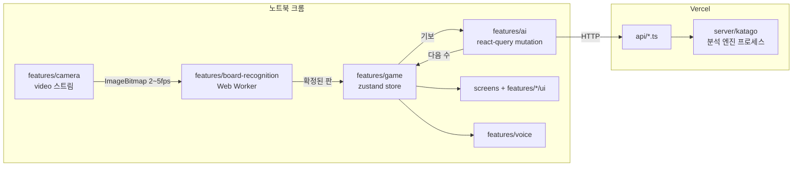

# ghost-go 아키텍처

2026-11-16 · 기획서(`docs/기획서.md`)를 구현하기 위한 구조와 규칙이에요. cogroom-mobile의 아키텍처를 웹 + Vercel 함수에 맞게 옮겼어요.

## 1. 한눈에 보기

- **프론트**: React + Vite SPA예요. 카메라, 판 인식, 바둑 규칙, 대국 진행, 화면, 음성을 모두 브라우저에서 처리해요.
- **백엔드**: Vercel 함수 3개(`/api/warmup`, `/api/move`, `/api/score`)예요. KataGo 분석 엔진을 띄워 두고 기보를 받아 답만 돌려줘요. DB와 로그인은 없어요.
- **배포**: 레포 1개 = Vercel 프로젝트 1개예요. `main`에 머지하면 프로덕션에 배포돼요.
- **언어**: 화면과 음성 문구는 **영어**예요(사용자가 외국인 친구). 문서와 코드 주석은 한국어로 써요.



## 2. 폴더 구조

```
api/                          # Vercel 함수 진입점 (Vercel 규칙상 루트 api/). 얇게 유지
  warmup.ts  move.ts  score.ts
server/
  katago/                     # 프로세스 관리, 질의 작성, 응답 해석
  http/                       # 요청 검증(zod), 에러 응답 공통
scripts/
  fetch-katago.sh             # 빌드 시 KataGo 바이너리·모델 다운로드 (레포에 커밋하지 않음)
src/
  app/                        # 진입점: Provider 조립, 대국 단계에 따라 screen 선택, 에러 경계
  screens/                    # 화면 = feature 조립 (상태 로직은 두지 않음)
    camera-setup/
    board-setup/
    game-settings/
    game/
  features/
    camera/                   # 장치 목록, 스트림 열기, 끊김 감지
    board-recognition/        # 원근 변환, 판 크기 인식, 돌 판정, 움직임 감지 (Worker)
    game/                     # 바둑 규칙, 대국 상태 흐름, 판 변화 해석, 무르기·판 고치기
    ai/                       # /api 호출 훅, 기력 목록, warmup
    scoring/                  # 집계산 결과, 집 영역 표시
    voice/                    # 음성 안내 (speechSynthesis)
  shared/
    api/                      # fetch client(send), ApiError, 요청·응답 zod 스키마 (프론트·백 공용)
    lib/
      go/                     # 좌표, 색, 수, 기보 타입과 변환 (프론트·백 공용)
      i18n/                   # i18next, locales/en.ts
      storage/                # localStorage 읽기·쓰기 (zod 검증)
    ui/                       # 버튼, 패널, 토스트 같은 공용 컴포넌트
    hooks/
    styles/                   # global.css (Tailwind v4 토큰)
fixtures/
  boards/                     # 판 인식 테스트용 실제 사진 + 정답 JSON
docs/
```

각 feature 안은 cogroom-mobile과 같이 나눠요.

| 폴더 | 들어가는 것 |
| --- | --- |
| `lib/` | 순수 함수, 상수, 타입. React를 모름. 테스트를 같은 폴더에 붙여요(`*.test.ts`) |
| `model/` | 훅, zustand store, react-query mutation. lib를 엮어서 상태를 만들어요 |
| `ui/` | 그 feature의 컴포넌트. 표시와 사용자 동작만 다뤄요 |
| `worker/` | (board-recognition만) Web Worker 진입점 |

## 3. 의존 규칙

```
app → screens → features → shared
api/ → server/ → src/shared/{api,lib/go}
```

- 아래 레이어는 위 레이어를 import하지 않아요. `shared`는 feature를 모르고, feature는 screen을 몰라요.
- feature끼리는 `lib`과 `model`의 공개 export만 가져다 써요. 예: `game`이 `board-recognition/lib`의 `BoardSnapshot` 타입을 씀.
- 백엔드(`api/`, `server/`)는 `src/shared/api`(스키마)와 `src/shared/lib/go`(바둑 타입)만 써요. 이 두 곳에는 브라우저 API를 넣지 않아요.
- 백엔드 코드는 `@/` 별칭 대신 **상대 경로**로 import해요. Vercel 함수 번들러가 tsconfig 별칭을 보장하지 않아서예요.

## 4. Feature별 책임

### camera
- `model/use-camera-stream.ts`: 장치 목록(`enumerateDevices`), 아이폰(연속성 카메라)으로 보이는 장치 우선 선택, 선택한 장치 기억, 스트림 끊김(`track.onended`) 감지
- `ui/camera-picker.tsx`, `ui/camera-view.tsx`

### board-recognition
판 인식 알고리즘은 모두 `lib`의 순수 함수예요. Worker는 그 함수를 부르기만 해요.

| 모듈 | 하는 일 |
| --- | --- |
| `lib/homography.ts` | 네 모서리 → 3×3 원근 행렬, 점 변환 |
| `lib/warp.ts` | 프레임을 정사각형으로 펴기 (작은 해상도) |
| `lib/grid-size.ts` | 투영 프로파일로 9/13/19 점수 매기기 → `{ size, confidence }` |
| `lib/calibration.ts` | 빈 판 교차점별 밝기 기준값, 돌 높이 보정량 |
| `lib/classify.ts` | 교차점별 빈칸/흑/백 판정 → `BoardSnapshot` |
| `lib/motion.ts` | 이전 프레임과의 차이 → 손이 있는지 판단 |
| `lib/stabilizer.ts` | 조용해진 뒤 N번 연속 같은 판이면 확정 |
| `worker/recognition.worker.ts` | Comlink로 `configure(corners, size, calibration)`, `analyze(frame)` 노출 |
| `model/use-board-recognition.ts` | video에서 2~5fps로 `ImageBitmap`을 떠서 Worker로 넘기고, 확정된 판을 내보냄 |
| `ui/corner-picker.tsx`, `ui/overlay-grid.tsx` | 모서리 클릭, 영상 위 격자 표시 |

프레임은 `createImageBitmap(video)`로 떠서 **transfer**로 넘겨요(복사 없음). 원본 해상도 대신 판 영역만 작게 펴서 계산해요.

### game
앱의 핵심 상태는 이 feature의 store 하나예요.

| 모듈 | 하는 일 |
| --- | --- |
| `lib/rules.ts` | 착수, 따내기, 자충수, 단순 패 판정. 불변 `Position`을 다룸 |
| `lib/phase.ts` | 대국 단계 타입과 전이 함수 (아래) |
| `lib/interpret-change.ts` | (현재 단계, 기대 판, 인식된 판) → 이벤트 (`humanMoved`, `aiStonePlaced`, `stonesRemoved`, `mismatch`) |
| `model/game-store.ts` | zustand store. 단계, 기보, 현재 `Position`, 설정. localStorage에 저장·복구 |
| `ui/board-canvas.tsx` | 인식된 판, AI 다음 수, X 표시, 집 영역 그리기. 교차점 클릭으로 판 고치기 |
| `ui/game-controls.tsx` | Pass, Resign, Undo, Edit board, Recalibrate |

대국 단계는 구분 가능한 유니언(discriminated union)으로 표현해요. 단계마다 필요한 데이터가 다르기 때문이에요.

```ts
type GamePhase =
  | { kind: 'humanTurn' }
  | { kind: 'aiThinking' }
  | { kind: 'awaitingAiStone'; move: Coord }
  | { kind: 'awaitingRemoval'; stones: Coord[] }
  | { kind: 'mismatch'; diff: Coord[]; resumeTo: GamePhase }
  | { kind: 'ended'; result: GameResult };
```

판 인식 결과를 받아 store를 바꾸는 흐름은 다음과 같아요. 인식된 판을 해석해서(`interpretChange`) 이벤트를 만들고, 그 이벤트로 단계를 바꿔요(`transition`). AI 차례가 되면 `features/ai`의 mutation을 불러요. 연결은 `screens/game`에서 해요.

### ai
- `model/use-ai-move.ts`, `model/use-score.ts`: react-query `useMutation` + `shared/api` 스키마
- `model/use-warmup.ts`: 사이트를 열 때 1번, 대국 중에는 90초마다 호출
- `lib/ranks.ts`: 화면에 보여줄 기력 목록 ↔ KataGo `humanSLProfile` 값 매핑

### scoring
- `/api/score` 결과(`ownership`, `deadStones`, `result`)를 화면용 데이터로 바꿈
- `ui/score-overlay.tsx`, `ui/result-panel.tsx`

### voice
- `lib/phrases.ts`: 좌표를 읽을 문장으로 바꿈. 예: `D16` → "White, D 16"
- `model/use-voice.ts`: `speechSynthesis`, `en-US` 목소리 선택, 겹치는 안내는 앞의 것 취소. 첫 클릭("Start game") 때 음성을 켜요

## 5. API 계약

스키마는 `src/shared/api/schemas.ts`에 zod로 한 번만 정의해요. 프론트는 응답을 검증하고, 함수는 요청을 검증해요.

```ts
// 좌표는 GTP 형식 문자열 ("D16"), 수는 { color, move: 'D16' | 'pass' }
MoveRequest  = { size: 9 | 13 | 19, moves: Move[], aiColor: 'B' | 'W', rank: Rank, komi: number }
MoveResponse = { move: Vertex | 'pass' | 'resign', winrate: number }
ScoreRequest = { size, moves, komi }
ScoreResponse = { ownership: number[], deadStones: Vertex[], result: string }  // "B+3.5"
```

- 서버는 상태를 저장하지 않아요. 매번 전체 기보를 받아요.
- 에러는 `{ code, message }`로 내려요. 화면 문구는 프론트가 `code`를 보고 정해요(cogroom-mobile과 같음).

## 6. 백엔드 구조

- `server/katago/engine.ts`
  - 함수 인스턴스 안에서 KataGo `analysis` 프로세스를 **한 번만** 띄우는 싱글턴이에요. stdin에 JSON 질의를 쓰고, stdout을 `id`별로 받아요.
  - 프로세스가 죽으면 다음 요청에서 다시 띄워요. 응답 시간이 넘으면 타임아웃 에러를 내요.
- `server/katago/query.ts`: `MoveRequest` → KataGo 질의
  - `rules: "korean"`, `komi`, `humanSLProfile`(기력), `maxVisits` 작게
  - 점수 질의에는 `includeOwnership`을 켜요
- `server/katago/pick-move.ts`: 응답의 human policy에서 확률대로 수를 뽑아요. 승률이 아주 낮게 이어지면 `resign`을 돌려요.
- 바이너리와 모델은 `scripts/fetch-katago.sh`로 **빌드할 때 받아요**. 둘 다 크고 라이선스가 따로 있어서 레포에 커밋하지 않아요. 함수 설정의 `includeFiles`로 번들에 넣어요.
- 위 내용은 0단계 검증 결과에 따라 바뀔 수 있어요. 안 되면 `onnxruntime-node` 방식으로 가요(기획서 5.3 참고).

## 7. 화면 문구 (i18n)

- i18next + `src/shared/lib/i18n/locales/en.ts` 하나만 둬요.
- 화면 문구와 음성 문구는 모두 로케일에 둬요. 코드에서는 `t()`로 써요.
- ESLint로 JSX 안의 맨 문자열(`JSXText`에 영문자가 있는 경우)을 막아요. cogroom-mobile의 "코드에 한글 문구 금지" 규칙을 영어용으로 바꾼 거예요.

## 8. 기술 스택

| 영역 | 선택 |
| --- | --- |
| 런타임·패키지 | Node.js 24, pnpm |
| 언어 | TypeScript strict, `@/*` → `src/*` |
| 프론트 | React 19 + Vite + React Compiler |
| 스타일 | Tailwind CSS v4 + tailwind-variants + tailwind-merge |
| 상태 | zustand (대국 상태), @tanstack/react-query (API 호출) |
| 검증 | zod (API 스키마, 저장 데이터) |
| Worker | Comlink |
| 판 인식 | 직접 구현 (OpenCV 안 씀) |
| 음성 | Web Speech API (`speechSynthesis`) |
| 백엔드 | Vercel Functions (Node.js), KataGo 분석 엔진 + Human SL 모델 |
| 테스트 | Vitest (+ Testing Library) |
| 린트·포맷 | ESLint `@antfu/eslint-config` (cogroom-mobile 규칙 그대로) |
| 커밋 품질 | husky + lint-staged + commitlint |

ESLint 커스텀 규칙은 cogroom-mobile과 같아요.
- `max-params: 3`, `max-lines-per-function: 110`, `curly: all`
- kebab-case 파일명, `type` 사용(`interface` 안 씀), `consistent-type-imports`
- stylistic 들여쓰기 2칸, 작은따옴표, 세미콜론

React Native 전용 규칙(reanimated 관련 등)은 빼요.

## 9. 테스트 전략

| 대상 | 방법 |
| --- | --- |
| `game/lib/rules.ts` | 따내기, 자충수, 패, 단수 같은 경우를 단위 테스트 |
| `game/lib/phase.ts`, `interpret-change.ts` | 단계 × 이벤트 표를 테스트로 |
| `board-recognition/lib/*` | `fixtures/boards`의 실제 사진으로 판 크기·돌 정확도 측정. 기준(기획서 7장) 아래로 떨어지면 실패 |
| `server/katago/query.ts`, `pick-move.ts` | 질의 모양, 수 고르기를 단위 테스트 (KataGo 없이) |
| API 함수 | 0단계에서 배포 환경으로 직접 확인 |

`pnpm check-all` = lint + type-check + test예요.

## 10. Git 전략

- **브랜치**: `main` + 작업 브랜치만 둬요. `develop`은 없어요.
  - 작업 브랜치 이름: `<type>/<kebab-설명>` (예: `feature/board-recognition`, `fix/ko-detection`)
- **PR**: 작업 브랜치 → `main`, **squash merge**. 머지하면 Vercel 프로덕션에 배포되고, PR마다 미리보기 배포가 생겨요.
- **커밋**: Conventional Commits + 한글 요약 (cogroom 규칙과 같음). 예: `feat(board-recognition): 판 크기 자동 인식 추가`
- husky `pre-commit`으로 `main`에 직접 커밋하는 걸 막아요.
- **커밋과 PR에 AI 작성 표시(Co-Authored-By, "Generated with ..." 등)를 붙이지 않아요.**
